<picture>
  <source media="(prefers-color-scheme: light)" srcset="assets/light/hero.svg">
  
</picture>

I'm a B.Tech CSE student specialising in AI & Data Science. I like building things that work end to end: research agents, forecasting pipelines, and the systems-level code underneath. I'd rather report what I measured than what I hoped for, so every project below says what it is and nothing more.

**Looking for:** SDE and AI/ML internships, technical research.

### Stack

Also in coursework: C, SQL (PL/SQL), JavaScript, Assembly, Lex.

### Projects

- **[SciLens](https://github.com/ananyamarghade/SciLens-Automated-Research-Gap-Identification)**: a research-gap agent that searches OpenAlex, Semantic Scholar, CrossRef and arXiv, then uses a LangGraph critic loop to check each candidate gap against evidence. `Python` `LangGraph` `FastAPI`
- **[Hospital OPD Early Warning System](https://github.com/ananyamarghade/Hospital-OPD-Early-Warning-System)**: predicts whether an OPD or emergency department will be overloaded three days ahead, from 143,000+ patient records. `Python` `Random Forest`
- **[Thread-safe LRU cache](https://github.com/ananyamarghade/Thread-Safe-In-Memory-Key-Value-Store-with-LRU-Eviction)**: an in-memory key-value store with LRU eviction, built around a hash map and a doubly linked list under a lock. `Java` `Maven`
- **[Driver Drowsiness Detection](https://github.com/ananyamarghade/Driver-Drowsiness-Detection-System-with-UI)**: watches eye aspect ratio from a webcam and sounds an alert on prolonged eye closure. `Python` `OpenCV` `Dlib`

The rest, including labs and hackathon work, is on [my repositories page](https://github.com/ananyamarghade?tab=repositories).

### Activity

<picture>
  <source media="(prefers-color-scheme: light)" srcset="assets/light/dashboard.svg">
  
</picture>

<a href="https://github.com/ananyamarghade">github.com/ananyamarghade</a>

