<a id="top"></a>

<picture>
  <source media="(prefers-color-scheme: light)" srcset="assets/light/hero.svg">
  
</picture>

<p align="center">
  <a href="#identity">identity</a> ·
  <a href="#dashboard">dashboard</a> ·
  <a href="#projects">projects</a> ·
  <a href="#system-map">system map</a> ·
  <a href="#contact">contact</a>
</p>

<a id="identity"></a>
<picture>
  <source media="(prefers-color-scheme: light)" srcset="assets/light/section-identity.svg">
  
</picture>

<picture>
  <source media="(prefers-color-scheme: light)" srcset="assets/light/identity.svg">
  
</picture>

<details>
<summary>identity as plain text</summary>

```text
ananya@marghade
Role:             B.Tech CSE, AI & Data Science
Focus:            AI engineering, software, data systems, research
Building:         agents, forecasting, decision support
Seeking:          SDE and AI/ML internships, technical research
Team:             DimensionAI, lead on Aasha
Lang.Programming: Python, Java, TypeScript, JavaScript, C
Lang.Query:       SQL (PL/SQL)
Lang.Low:         Assembly, Lex
ML:               LangGraph, Random Forest, OpenCV, Dlib
Web:              FastAPI, Gradio, Next.js, Tailwind, Supabase
GitHub:           github.com/ananyamarghade
```

</details>

<a id="dashboard"></a>
<picture>
  <source media="(prefers-color-scheme: light)" srcset="assets/light/section-dashboard.svg">
  
</picture>

<picture>
  <source media="(prefers-color-scheme: light)" srcset="assets/light/dashboard.svg">
  
</picture>

Everything on this dashboard comes from my public GitHub pages and is refreshed daily by a GitHub Action. Counts describe activity, not skill.

<a id="projects"></a>
<picture>
  <source media="(prefers-color-scheme: light)" srcset="assets/light/section-projects.svg">
  
</picture>

<picture>
  <source media="(prefers-color-scheme: light)" srcset="assets/light/project-scilens.svg">
  
</picture>

> **SciLens**: a research-gap agent. It searches OpenAlex, Semantic Scholar, CrossRef and arXiv, extracts methods and limitations per paper, and a LangGraph critic loop checks each candidate gap against evidence. Novelty is graded (`well_supported`, `potential_gap`, `insufficient_evidence`), not asserted. Live demo linked from the repo.
> [repository](https://github.com/ananyamarghade/SciLens-Automated-Research-Gap-Identification) · [live demo](https://sci-lens-automated-research-gap-ide-nu.vercel.app/)

<picture>
  <source media="(prefers-color-scheme: light)" srcset="assets/light/project-opd-warning.svg">
  
</picture>

> **Hospital OPD Early Warning System**: predicts whether an OPD or emergency department will be overloaded three days ahead, from 143,000+ patient records. Rolling-window features, overload defined as the top 10% stress days, labels shifted forward, time-based split, class-weighted Random Forest. The repo README reports ROC-AUC ≈ 0.81 and PR-AUC ≈ 0.51; those are the project's own figures, not independently validated.
> [repository](https://github.com/ananyamarghade/Hospital-OPD-Early-Warning-System)

<picture>
  <source media="(prefers-color-scheme: light)" srcset="assets/light/project-lru-cache.svg">
  
</picture>

> **Thread-safe LRU cache**: Java, Maven. A HashMap indexes a doubly linked list that tracks recency. Even `get()` takes the write lock because it reorders the list; the design doc explains why this beats a synchronised `LinkedHashMap`. Its sharding section is design discussion, not implementation.
> [repository](https://github.com/ananyamarghade/Thread-Safe-In-Memory-Key-Value-Store-with-LRU-Eviction)

<picture>
  <source media="(prefers-color-scheme: light)" srcset="assets/light/project-aasha.svg">
  
</picture>

> **Project Aasha**: a design for a voice-first, offline-first decision-support co-pilot for India's ASHA and ANM health workers. I lead team DimensionAI. Design stage: the repo holds a README and `design.md`, and the stack listed there is proposed, not built. Decision support only; it does not diagnose.
> [repository](https://github.com/ananyamarghade/-Project-Aasha-The-AI-Medical-Co-Pilot-)

<picture>
  <source media="(prefers-color-scheme: light)" srcset="assets/light/project-senentialai.svg">
  
</picture>

> **SenentialAI**: a Next.js and TypeScript web app with Tailwind, Radix UI and Supabase migrations, organised around analyze, dashboard, history, reports and settings. The repo README is empty, so I'm not claiming how detection works or how well.
> [repository](https://github.com/ananyamarghade/SenentialAI-AI-Powered-Behavioral-Scam-Detection-Defense-System)

<details>
<summary>more on the shelf</summary>

<br>

- [Driver-Drowsiness-Detection-System-with-UI](https://github.com/ananyamarghade/Driver-Drowsiness-Detection-System-with-UI): webcam eye-aspect-ratio monitoring with OpenCV and Dlib; sounds an alert on prolonged eye closure.
- [forage-midas](https://github.com/ananyamarghade/forage-midas): project repo for the JPMC Advanced Software Engineering Forage program (Java).
- Hackathon work: [Hack-o-week-Odd-Sem-V_2026-2027](https://github.com/ananyamarghade/Hack-o-week-Odd-Sem-V_2026-2027), [Group 50 project](https://github.com/ananyamarghade/Intelligent-Systems-Engineering-Projects-Hack-o-week-Group-50-).
- Labs: [Data Structures](https://github.com/ananyamarghade/Data-Structures) (C), [DAA](https://github.com/ananyamarghade/Design-and-Analysis-of-Algorithms-DAA-Practicals), [DBMS](https://github.com/ananyamarghade/Database-Management-Systems-Lab) (PL/SQL), [Compiler Construction](https://github.com/ananyamarghade/Compiler-Construction-Lab) (Lex), [Microcontrollers](https://github.com/ananyamarghade/Microcontrollers-and-Embedded-Systems-CA-I) (Assembly), [Java](https://github.com/ananyamarghade/Java-Foundation), [JavaScript](https://github.com/ananyamarghade/JavaScript-Lab), [PPS](https://github.com/ananyamarghade/PPS-LAB).

</details>

<a id="system-map"></a>
<picture>
  <source media="(prefers-color-scheme: light)" srcset="assets/light/section-system-map.svg">
  
</picture>

<picture>
  <source media="(prefers-color-scheme: light)" srcset="assets/light/toolkit-map.svg">
  
</picture>

Only technologies that appear in my repositories; each route is a project that uses them.

```text
how I work
  evidence before claims      if I haven't measured it, it isn't a result
  useful systems over demos   start from who uses it and what they do next
  predictions are hypotheses  until something checks them
  say what's unfinished       a design is a design, a prototype is a prototype
```

<a id="contact"></a>
<picture>
  <source media="(prefers-color-scheme: light)" srcset="assets/light/section-contact.svg">
  
</picture>

GitHub is the best place to reach me for now: [github.com/ananyamarghade](https://github.com/ananyamarghade).

<picture>
  <source media="(prefers-color-scheme: light)" srcset="assets/light/closing.svg">
  
</picture>

<p align="center"><a href="#top">back to top</a></p>

<details>
<summary>one more thing</summary>

<br>

The cache from my LRU project, before and after `get(7)`:

```text
HEAD <-> [k=3] <-> [k=1] <-> [k=7] <-> TAIL      k=7 is next to be evicted
HEAD <-> [k=7] <-> [k=3] <-> [k=1] <-> TAIL      k=7 moved to the front
```

</details>
