<picture>
  <source media="(prefers-color-scheme: light)" srcset="assets/light/hero.svg">
  
</picture>

checkpoints saved so far. Click one to open the repo.

<table>
<tr>
<td width="50%" valign="top">
<a href="https://github.com/ananyamarghade/SciLens-Automated-Research-Gap-Identification"><picture>
<source media="(prefers-color-scheme: light)" srcset="assets/light/cp-scilens.svg">

</picture></a>
<b><a href="https://github.com/ananyamarghade/SciLens-Automated-Research-Gap-Identification">SciLens</a></b> 
A research-gap agent: searches four paper databases and uses a LangGraph critic loop to check each candidate gap against evidence. 
`Python` `LangGraph` `FastAPI`
</td>
<td width="50%" valign="top">
<a href="https://github.com/ananyamarghade/Hospital-OPD-Early-Warning-System"><picture>
<source media="(prefers-color-scheme: light)" srcset="assets/light/cp-opd.svg">

</picture></a>
<b><a href="https://github.com/ananyamarghade/Hospital-OPD-Early-Warning-System">Hospital OPD Early Warning System</a></b> 
Predicts whether an OPD or emergency department will be overloaded three days ahead, from 143,000+ patient records. 
`Python` `Random Forest`
</td>
</tr>
<tr>
<td width="50%" valign="top">
<a href="https://github.com/ananyamarghade/Thread-Safe-In-Memory-Key-Value-Store-with-LRU-Eviction"><picture>
<source media="(prefers-color-scheme: light)" srcset="assets/light/cp-lru.svg">

</picture></a>
<b><a href="https://github.com/ananyamarghade/Thread-Safe-In-Memory-Key-Value-Store-with-LRU-Eviction">Thread-safe LRU cache</a></b> 
An in-memory key-value store with LRU eviction, built on a hash map and a doubly linked list under a lock. 
`Java` `Maven`
</td>
<td width="50%" valign="top">
<a href="https://github.com/ananyamarghade/Driver-Drowsiness-Detection-System-with-UI"><picture>
<source media="(prefers-color-scheme: light)" srcset="assets/light/cp-drowsiness.svg">

</picture></a>
<b><a href="https://github.com/ananyamarghade/Driver-Drowsiness-Detection-System-with-UI">Driver Drowsiness Detection</a></b> 
Watches eye aspect ratio from a webcam and sounds an alert on prolonged eye closure. 
`Python` `OpenCV` `Dlib`
</td>
</tr>
</table>

<code>exit 0</code> &nbsp;·&nbsp; <a href="https://github.com/ananyamarghade">github.com/ananyamarghade</a> &nbsp;·&nbsp; <a href="https://github.com/ananyamarghade?tab=repositories">all repositories</a>

